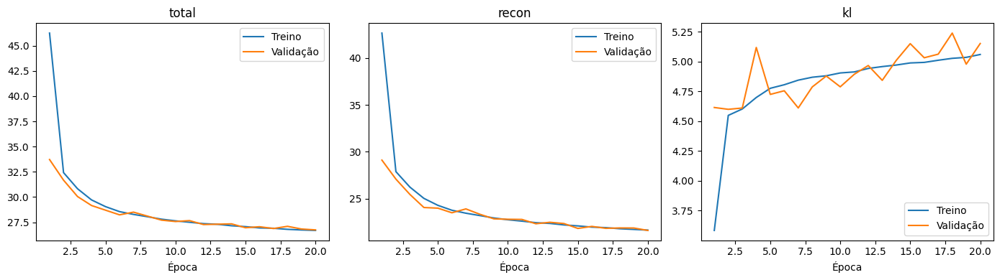
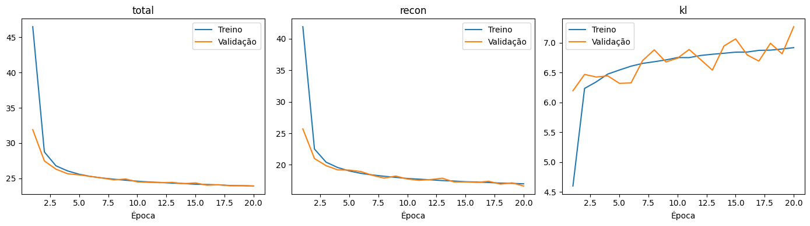
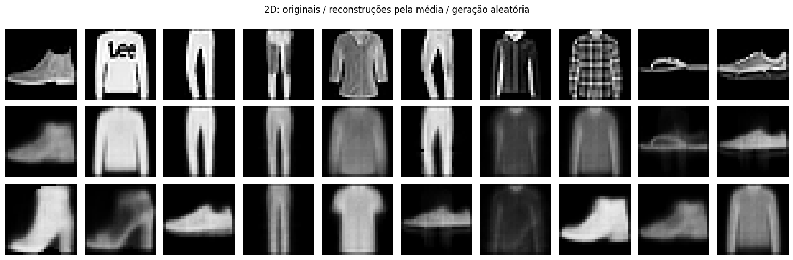
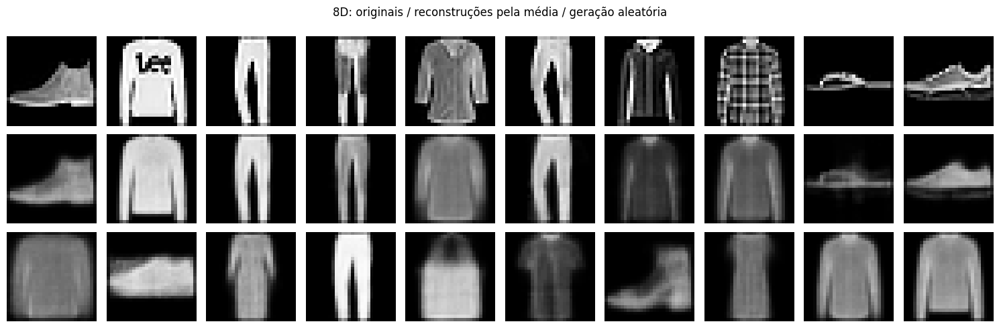
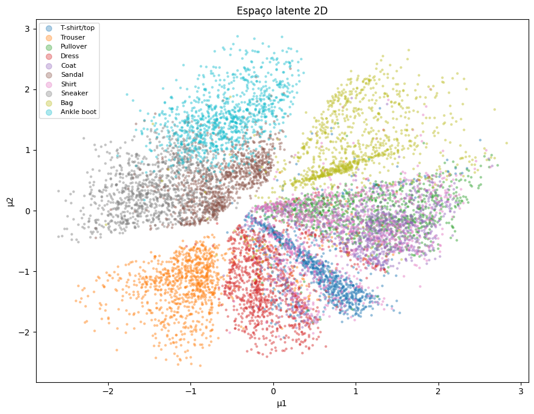
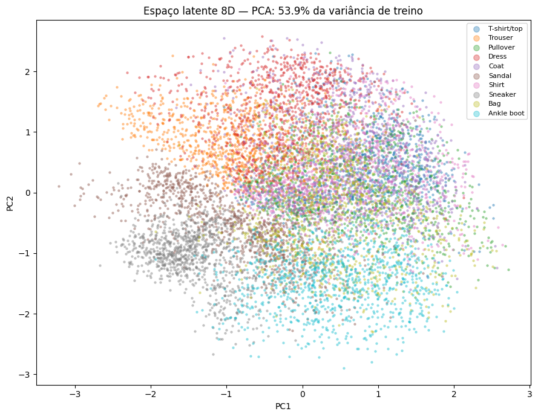

# Projeto 3: Geração de Imagens e Exploração do Espaço Latente com VAEs

Disciplina: Introdução às Redes Neurais Artificiais

Autor: Marcos Vinicius Gasparoto Bauab (RA: 156.717)

Repositório / Código reprodutível: https://github.com/MarcosBauab/unifespRNA/tree/main

## Resumo

Este trabalho investiga autoencoders variacionais (VAEs) na geração e reconstrução de imagens do Fashion-MNIST, comparando espaços latentes de duas e oito dimensões. Foram avaliadas quatro configurações por dimensionalidade, combinando duas topologias densas e duas taxas de aprendizado, com seleção pelo menor custo de validação. As duas buscas selecionaram o encoder de 512 e 256 neurônios, decoder espelhado e taxa de 0,001. No teste, o custo total foi 26,7826 para o VAE 2D e 24,0350 para o VAE 8D; o segundo reduziu o erro de reconstrução em 22,4%. A representação 2D apresentou agrupamentos visuais parcialmente associados às classes. A projeção PCA do espaço 8D preservou 53,9% da variância das médias latentes de treino e exibiu sobreposição entre categorias. Os resultados indicam vantagens distintas da representação compacta para visualização e da representação 8D para reconstrução, dentro do orçamento e das configurações avaliados.

Palavras-chave: autoencoder variacional; Fashion-MNIST; modelos generativos; espaço latente; PCA.

## 1. Configuração Experimental e Reprodutibilidade

### 1.1. Dados, pré-processamento e partições

O Fashion-MNIST contém 70 mil imagens em tons de cinza de 28 × 28 pixels, distribuídas entre dez categorias de vestuário e acessórios [1]. Neste experimento, os 60 mil exemplos do conjunto oficial de treino foram separados aleatoriamente em 50 mil para treinamento e 10 mil para validação. A divisão estratificada preservou as proporções das classes e utilizou semente 42. Os 10 mil exemplos do teste oficial foram reservados para a avaliação final.

Cada imagem foi convertida para ponto flutuante e seus pixels foram divididos por 255, resultando em valores no intervalo [0,1]. Essa transformação usa uma escala conhecida, sem estimar estatísticas nas partições. A entrada foi reorganizada em um vetor de 784 valores. Os rótulos foram empregados na estratificação e na visualização, sem serem fornecidos ao encoder ou ao decoder. O treinamento foi, portanto, não supervisionado.

A seleção de arquitetura, taxa de aprendizado e época utilizou somente o custo na validação. O teste foi utilizado após a seleção dos dois vencedores. A organização deste relatório segue os tópicos do template da disciplina e do relatório do Projeto 2, com métodos adaptados à tarefa generativa.

### 1.2. Modelo variacional e função de custo

O VAE representa cada entrada por uma distribuição normal de covariância diagonal no espaço latente, em vez de um único código determinístico. O encoder produz os vetores de média e log-variância. A amostragem usa a reparametrização, que permite propagar os gradientes através da transformação que depende dos parâmetros aprendidos [2].

z = mu(x) + exp(0,5 · logvar(x)) · epsilon, com epsilon ~ N(0, I).

O produto acima é aplicado elemento a elemento. O decoder recebe z e produz 784 intensidades, com ativação sigmoid na saída. As camadas ocultas usam ReLU. Foram considerados encoders com camadas [256,128] e [512,256], seguidos de duas saídas lineares com dimensão 2 ou 8. O decoder utiliza as camadas ocultas na ordem inversa. Por exemplo, o vencedor 2D segue o caminho 784 → 512 → 256 → distribuição 2D → 256 → 512 → 784.

A função de custo por imagem soma o erro quadrático de reconstrução e a divergência KL entre a distribuição produzida pelo encoder e a normal padrão. Não foi aplicado peso adicional ao termo KL: seu coeficiente é 1, seguindo a formulação apresentada na Aula 16 [3].

Reconstrução = soma, sobre os 784 pixels, de (x - x_reconstruído)².

KL = -0,5 · soma, sobre as dimensões latentes, de [1 + logvar - mu² - exp(logvar)].

Custo total = reconstrução + KL; o treinamento minimiza a média desse custo no lote.

Os valores reportados não são MSE médio por pixel: o termo de reconstrução é somado nos pixels antes da média entre imagens. A reconstrução incentiva fidelidade à entrada, enquanto a KL penaliza distribuições latentes afastadas da normal padrão. Essa regularização favorece a amostragem generativa, mas não impõe separação entre as classes.

### 1.3. Busca de hiperparâmetros e execução

A busca foi realizada independentemente para os espaços 2D e 8D, com quatro combinações em cada caso. O otimizador foi Adam com parâmetros padrão do PyTorch, sem regularização adicional, lotes de 256 e até 20 épocas. A parada antecipada foi configurada com paciência de quatro épocas sem melhora estrita na validação, salvando os pesos a cada novo mínimo.

Tabela 1: Espaço de busca e parâmetros compartilhados.

| Parâmetro | Configurações |
| --- | --- |
| Dimensão latente | 2 e 8; seleção independente |
| Camadas ocultas do encoder | [256,128] ou [512,256] |
| Camadas ocultas do decoder | Ordem inversa do encoder |
| Taxa de aprendizado | 0,001 ou 0,0003 |
| Ativações | ReLU nas ocultas; sigmoid na saída |
| Otimizador / lote | Adam / 256 |
| Limite / paciência | 20 épocas / 4 épocas |
| Semente de treinamento | 42 em cada execução |
| Seleção | Menor custo total de validação |

A execução ocorreu no Google Colab com dispositivo CUDA. O modelo da GPU e as versões completas das bibliotecas não constam nas saídas exportadas; o notebook registra Python, PyTorch e dispositivo em ambiente.json no diretório de resultados. As sementes de Python, NumPy e PyTorch foram fixadas, mas não foi ativado um modo de determinismo estrito das operações de GPU. Portanto, a semente não garante resultados idênticos entre ambientes.

A validação empregou uma amostra latente por imagem, reiniciando o gerador com semente 123 a cada avaliação e restaurando o estado do gerador após o procedimento. Isso reduz a variação da avaliação entre épocas. O mesmo procedimento foi usado no teste. O custo de treino é acumulado durante as atualizações da época; o de validação é calculado com os pesos ao final dela, de modo que as curvas não correspondem a avaliações simultâneas dos mesmos pesos.

Tabela 2: Busca completa; custo de validação no melhor checkpoint e duração total de cada execução.

| Latente | Encoder | Taxa | Custo val. | Melhor época | Tempo (s) |
| --- | --- | --- | --- | --- | --- |
| 2D | [256,128] | 0,001 | 27,2003 | 20 | 132,69 |
| 2D | [256,128] | 0,0003 | 28,6833 | 20 | 136,97 |
| 2D | [512,256] | 0,001 | 26,7464 | 20 | 136,29 |
| 2D | [512,256] | 0,0003 | 27,6383 | 19 | 140,26 |
| 8D | [256,128] | 0,001 | 24,1464 | 20 | 131,44 |
| 8D | [256,128] | 0,0003 | 25,4987 | 20 | 136,04 |
| 8D | [512,256] | 0,001 | 23,9134 | 20 | 136,24 |
| 8D | [512,256] | 0,0003 | 24,3497 | 20 | 132,80 |

Ambas as buscas selecionaram [512,256] com taxa 0,001. A arquitetura pôde variar por dimensionalidade, mas a escolha coincidiu nas alternativas avaliadas. Todas as execuções completaram 20 épocas; a parada antecipada não foi acionada. Sete das oito obtiveram o melhor custo na última época, o que limita qualquer afirmação de convergência. Os oito treinamentos somaram aproximadamente 18 minutos, incluindo o monitoramento e as gravações realizadas dentro do trecho cronometrado. Os tempos dependem do ambiente disponibilizado pelo Colab.

Para reproduzir, executar as células do notebook em ordem, mantendo MAX_EPOCHS = 20 e a divisão original. O diretório Projeto_3_VAE no Drive armazena partições, checkpoints, históricos, tabela de busca, métricas de teste, médias latentes e figuras. O arquivo exportado fashion_mnist_vae_web.ipynb contém as saídas da execução analisada neste artigo.

## 2. Dinâmica de Treinamento e Convergência

As Figuras 1 e 2 mostram o custo total e seus componentes para os vencedores. Em ambos os espaços, a maior queda ocorre nas primeiras épocas e é seguida por melhorias menores. Treino e validação permanecem próximos, sem afastamento persistente que indique sobreajuste evidente nesse intervalo. A validação inicialmente inferior ao treino é compatível com o fato de ser calculada após as atualizações da época, enquanto a média de treino inclui os primeiros lotes, avaliados com pesos menos ajustados.

O termo KL cresce enquanto o erro de reconstrução diminui. Essa evolução é compatível com o uso de distribuições latentes mais informativas sobre a entrada, mesmo com maior penalização por afastamento da normal padrão. O aumento isolado da KL não significa que o treinamento piorou, pois o objetivo é minimizar a soma dos dois termos. O custo total de validação dos vencedores alcançou seu mínimo na época 20; a estabilização visual não demonstra que mais épocas seriam inúteis.

## 3. Desempenho no Teste, Reconstrução e Geração

Após a seleção por validação, os checkpoints vencedores foram avaliados nas 10 mil imagens de teste. A Tabela 3 apresenta médias por imagem com amostragem latente. Não foram calculados intervalos de confiança ou desvios entre execuções, pois houve uma semente de treinamento por configuração.

Tabela 3: Avaliação final dos modelos selecionados; menor custo total e menor reconstrução são preferíveis.

| Modelo | Custo total | Reconstrução | KL |
| --- | --- | --- | --- |
| VAE 2D | 26,782567 | 21,637646 | 5,144921 |
| VAE 8D | 24,034963 | 16,786836 | 7,248127 |

O VAE 8D reduziu o custo total em aproximadamente 10,3% e o erro de reconstrução em 22,4% em relação ao 2D. A KL foi maior, mas a redução no erro de reconstrução compensou esse aumento. Assim, nas configurações avaliadas, oito dimensões proporcionaram um equilíbrio mais favorável segundo a função de custo. Os custos de teste ficaram próximos aos de validação: 26,7826 contra 26,7464 em 2D, e 24,0350 contra 23,9134 em 8D.

As reconstruções preservam silhuetas e diferenças gerais entre roupas e calçados, mas suavizam contornos e eliminam detalhes finos, como letras e estampas. O 8D apresenta menor erro agregado e exemplos com melhor preservação de forma, embora as imagens continuem desfocadas. Essa inspeção usa reconstruções determinísticas obtidas com z igual à média; já as métricas da Tabela 3 usam amostras da distribuição latente. Portanto, a figura ilustra o comportamento sem representar exatamente a mesma realização aleatória da avaliação numérica.

As imagens geradas apresentam formas reconhecíveis de vestuário e calçados, mas também suavização e ambiguidades. Sua presença mostra que o decoder pode produzir imagens sem receber uma entrada original. Não foi calculada uma métrica específica de qualidade ou diversidade generativa, de modo que não se conclui superioridade do 8D na geração apenas com o custo de reconstrução ou dez exemplos visuais. As gerações usam semente 42, porém vetores de dimensões diferentes; não formam pares diretamente comparáveis entre modelos.

## 4. Exploração do Espaço Latente e Discussão

### 4.1. Representação direta do VAE 2D

A Figura 5 representa as médias latentes das 10 mil imagens de teste. Cada ponto corresponde a uma imagem e sua cor identifica o rótulo original. Utilizar a média, em vez de uma amostra, elimina o ruído de amostragem dessa visualização. Os eixos não foram associados previamente a atributos físicos das roupas.

Há agrupamentos visuais associados a algumas categorias: calças concentram-se na região inferior esquerda, bolsas na superior direita e botas na superior esquerda. Tênis e sandálias ocupam regiões próximas à esquerda, com sobreposição parcial. Camisas, camisetas, casacos e pulôveres misturam-se principalmente nas regiões central e direita. Vestidos apresentam concentração inferior, também com interseções com outras classes.

Portanto, há organização e separação parcial dos rótulos, mas não dez grupos isolados. A semelhança de silhuetas entre peças superiores é uma interpretação plausível para parte da mistura observada. Essa análise é qualitativa: não foram ajustados algoritmos de agrupamento nem calculadas métricas de separação. Os rótulos apenas permitem interpretar a estrutura aprendida sem supervisão.

### 4.2. Projeção PCA do VAE 8D e variância explicada

O PCA foi ajustado exclusivamente nas médias latentes do treino, com centralização e sem padronização adicional, e aplicado às médias latentes de teste. Assim, o teste não definiu as direções de projeção. Os dois primeiros componentes explicam conjuntamente 53,9% da variância das médias latentes de treino, conforme o valor arredondado no gráfico exportado. A variância é calculada sobre as médias, não sobre amostras de z nem sobre os pixels.

A projeção mostra concentrações de calças na região superior esquerda, tênis na inferior esquerda e botas na parte inferior. Entretanto, várias classes se sobrepõem na região central. Aproximadamente 46,1% da variância das médias de treino está fora dos dois eixos mostrados. Esse percentual não corresponde a erro de classificação nem informa quanto da informação de classe foi perdido; o PCA preserva variância global, sem otimizar separação por rótulo.

A sobreposição projetada não permite concluir que os pontos estejam igualmente misturados nas oito dimensões. Da mesma forma, o aspecto mais separado do gráfico 2D não prova melhor capacidade generativa: ele mostra todas as coordenadas de um modelo treinado com gargalo de duas dimensões, enquanto o gráfico PCA mostra apenas parte da representação de outro modelo. Os 53,9% referem-se à variância de treino capturada pelas direções selecionadas, ainda que os pontos desenhados sejam de teste. Na representação direta 2D não há perda por projeção, mas continua existindo a compressão aprendida de 784 pixels para duas coordenadas.

### 4.3. Limitações e lições aprendidas

A busca cobriu somente duas topologias densas e duas taxas por dimensionalidade. O limite de 20 épocas foi alcançado por todas as configurações, com melhorias tardias frequentes. Os resultados identificam os melhores candidatos nesse orçamento, sem estabelecer a topologia ótima global ou convergência completa. Uma única semente não permite quantificar a variabilidade decorrente da inicialização e da ordem dos lotes.

A divergência KL incentiva aproximação à normal padrão, mas não garante classes separadas nem ausência de regiões de geração deficiente. A inspeção de poucos exemplos não mede cobertura, novidade ou fidelidade da distribuição gerada. Além disso, a perda quadrática e o gargalo comprimido podem favorecer reconstruções suavizadas; este experimento não isola a contribuição de cada fator para o desfoque observado.

O ajuste independente permitiu que os modelos adotassem arquiteturas diferentes, embora ambos tenham selecionado a mesma topologia. A comparação evidencia que capacidade de reconstrução e separação visual em dois eixos são critérios distintos. O uso das partições separadas e do PCA ajustado no treino mantém a avaliação final independente da seleção.

## 5. Conclusão

No orçamento avaliado, o VAE 8D obteve menor custo de teste e menor erro de reconstrução do que o VAE 2D. Ambos produziram imagens com formas reconhecíveis, ainda com perda de detalhes. A exploração latente revelou agrupamentos visuais e separação parcial dos rótulos; classes visualmente semelhantes permaneceram sobrepostas. O PCA do espaço 8D preservou 53,9% da variância das médias de treino em dois componentes, impondo cautela à interpretação da mistura no gráfico. Os resultados atendem à comparação entre as duas representações, sem demonstrar superioridade universal, convergência definitiva ou qualidade generativa quantitativa.

## Referências

[1] XIAO, H.; RASUL, K.; VOLLGRAF, R. Fashion-MNIST: a Novel Image Dataset for Benchmarking Machine Learning Algorithms. 2017. https://arxiv.org/abs/1708.07747

[2] KINGMA, D. P.; WELLING, M. Auto-Encoding Variational Bayes. ICLR, 2014. https://arxiv.org/abs/1312.6114

[3] Materiais da disciplina Introdução às Redes Neurais Artificiais: Aula16_VAE.pdf e redes_neurais_template_projetos.pdf. Estrutura de apresentação também orientada pelo relatório do Projeto 2 fornecido pelo autor.
